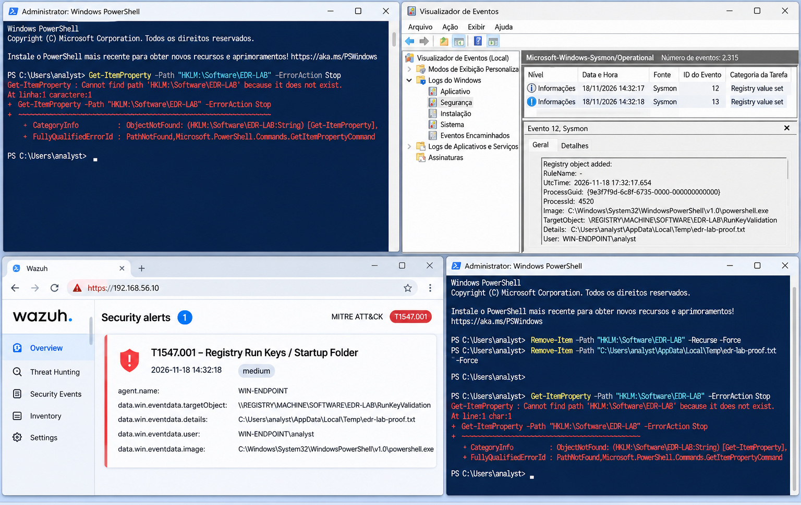

# 05 - Monitoramento de Alterações no Registro

## Objetivo

Criar um valor em uma chave de validação do laboratório e detectar a alteração com Sysmon.

**MITRE ATT&CK:** T1112 - Modify Registry
**Eventos-chave:** Sysmon EID 12 e EID 13

## Atividade controlada

O teste usa uma chave claramente identificável fora dos locais de inicialização automática. Ele registra uma alteração de registro, mas não demonstra persistência de execução.

Exemplo de registro:

```text
HKLM\Software\EDR-LAB\RunKeyValidation
```

Este arquivo não deve apontar para malware, ferramentas externas ou executaveis de terceiros.

## Campos a investigar

- `UtcTime`
- `Computer`
- `User`
- `Image`
- `ProcessId`
- `TargetObject`
- `Details`
- `RuleName`

## Validação

Use esta checagem em uma nova execução; ela não é o comando exibido na captura.

```powershell
$Path = "HKLM:\Software\EDR-LAB\RunKeyValidation"
if (Test-Path -LiteralPath $Path) {
    Get-ItemProperty -LiteralPath $Path
} else {
    Write-Output "Validation key does not exist: $Path"
}
```

O teste pode ser executado em `HKCU`, mas deve ser registrado qual nivel de privilégio foi usado.
A busca de hunting inclui a regra Wazuh `100013` para a alteração EDR-LAB; o
cartão de alerta isolado não exibe o ID. T1547.001 e a regra `100002` ficam
reservadas para alterações reais em `Run`/`RunOnce`.

## Procedimento

1. Criar snapshot do estado inicial.
2. Criar a chave de laboratorio.
3. Registrar o valor e seu processo criador.
4. Confirmar EID 12/13 no Sysmon.
5. Confirmar correlacao no Wazuh.
6. Registrar o processo associado ao teste.
7. Remover o valor.
8. Confirmar a remocao.

## Investigacao

- Confirmar se a chave pertence ao contexto esperado.
- Identificar o processo criador.
- Verificar usuario e privilegio.
- Relacionar com execucao anterior de PowerShell.
- Pesquisar todas as entradas do mesmo executavel.
- Determinar se a entrada foi ativada, instalada ou apenas criada.

## Resposta

- Remover a entrada maliciosa confirmada.
- Bloquear o arquivo associado.
- Investigar novas entradas no mesmo processo ou usuario.
- Restaurar o endpoint.
- Registrar a linha do tempo.

## Evidência do cenário



*A captura mostra os eventos Sysmon EID 12/13 e um alerta Wazuh marcado como
T1547.001/medium. As consultas PowerShell ao caminho base retornam
`PathNotFound` antes e depois do teste; por isso, essa captura não confirma o
estado inicial nem a remoção completa. O caminho do evento é
`HKLM\Software\EDR-LAB\RunKeyValidation`, classificado neste projeto como T1112.*
