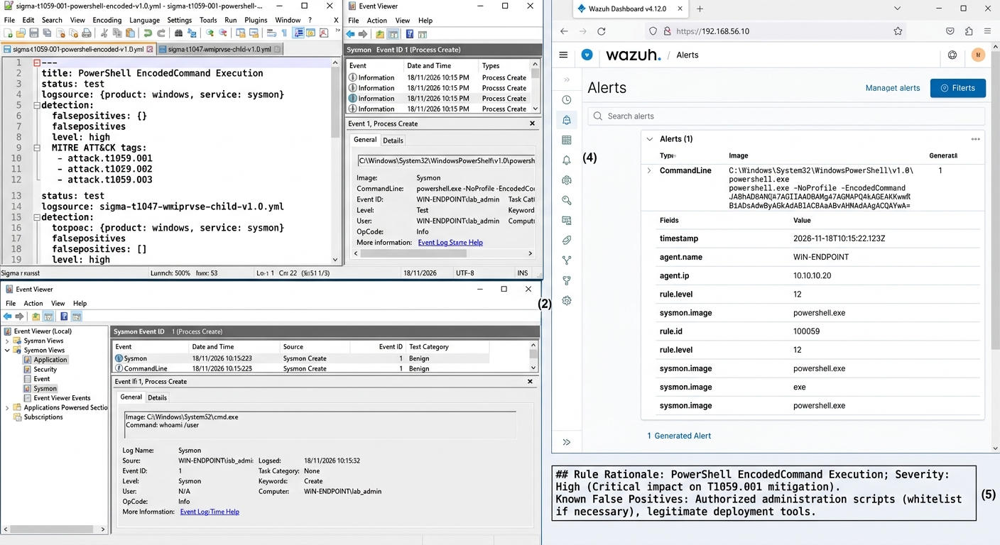

# 08 - Regras Sigma

Este modulo organiza regras de deteccao em formato Sigma e sua correspondencia no ambiente Wazuh.

## Objetivos

- Versionar regras legíveis.
- Documentar fonte da telemetria.
- Descrever falso positivo conhecido.
- Registrar cobertura MITRE.
- Manter criterios testaveis.

## Estrutura de uma regra

```yaml
title: PowerShell EncodedCommand Execution
status: test
description: Detects PowerShell execution with an encoded command argument.
logsource:
  product: windows
  category: process_creation
  service: sysmon
detection:
  selection:
    EventID: 1
    Image|endswith: '\powershell.exe'
  encoded:
    CommandLine|contains:
      - ' -enc '
      - ' -EncodedCommand '
  condition: selection and encoded
falsepositives:
  - Authorized administrative scripts
level: high
tags:
  - attack.execution
  - attack.t1059.001
```

## Mapeamento de regras

| Detecção | Sigma level | Wazuh Rule ID | Wazuh level |
|---|---|---:|---:|
| PowerShell com argumento codificado | high | 100059 | 12 |
| PowerShell iniciado por `cmd.exe` | — | 100001 | 3 |
| Alteração na chave de validação `EDR-LAB` | low | 100013 | 3 |
| Alteração em chave Run/RunOnce | high | 100002 | 12 |
| Processo filho de `WmiPrvSE.exe` | high | 100003 | 3 |

O ID `61603` mostrado em uma captura é a regra padrão do Wazuh para criação
de processo Sysmon, não uma regra Sigma ou local do projeto.

A captura Sigma aparenta concatenar duas regras e não mostra seleções/condições
completas; também lista T1059.002/.003, que não correspondem à execução de
PowerShell mostrada. As regras do projeto permanecem separadas, estruturadas e
com o mapeamento PowerShell correto T1059.001.

## Validacao

Cada regra deve ser validada contra:

- evento positivo do laboratorio;
- evento benigno conhecido;
- evento com campo ausente;
- evento em host diferente;
- duplicidade de alertas;
- formatacao suportada pelo parser;
- baixa taxa de falso positivo.

## Evidência do módulo



*Captura composta com regras Sigma no editor, eventos Sysmon EID 1, alerta correspondente no Wazuh e justificativa de severidade e falsos positivos.*
